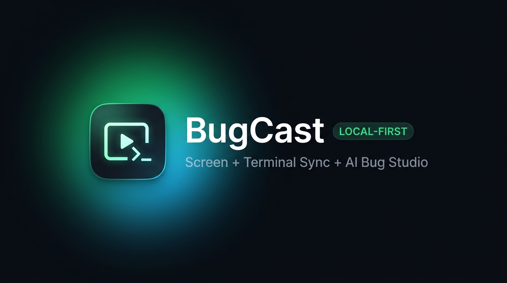
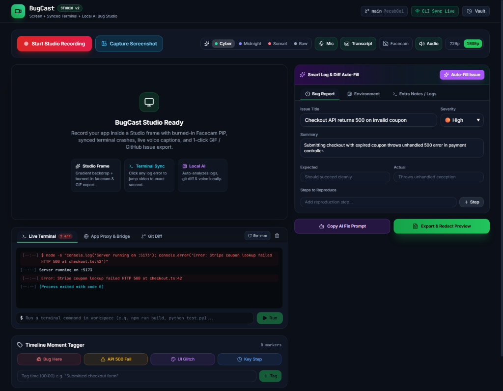
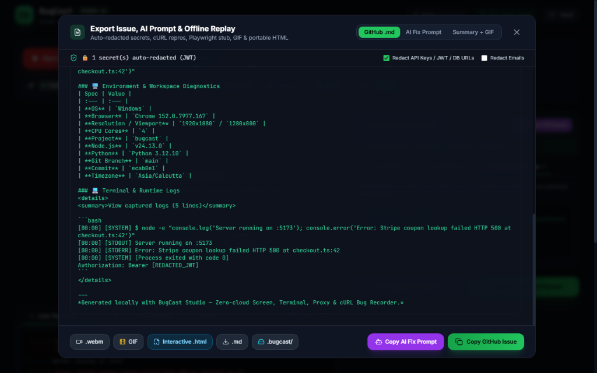

<p align="center">
  
</p>

# BugCast Studio v2

**A local-first developer bug studio combining Canvas screen recording, live terminal sync, zero-edit reverse app proxy, auto secret redaction, `cURL`/Playwright repro generation, offline interactive `.html` bundles, GIF export, and AI Fix Prompts.**

Zero cloud uploads. Zero subscriptions. Everything runs on your machine.

---

## Visual Tour

### 1. Studio Dashboard & Live Terminal Error Sync
*Record your window in a Studio frame while terminal crashes (`stderr` / HTTP `500`), git context, and voice narration sync automatically.*



### 2. Auto-Redacted GitHub Issues, GIF, Offline `.html` & AI Fix Prompts
*Secrets (`JWT`, API keys, DB URIs) are automatically masked before export, with 1-click `.gif`, standalone interactive `.html`, `.bugcast/` disk bundles, and AI Fix Prompts.*



---

## Why Developers Actually Use BugCast

BugCast eliminates the biggest frustrations when capturing and fixing bugs:

1. **🔒 Auto Secret & PII Redaction**: Automatically masks JWTs, API keys (`sk-...`, `ghp_...`, `AKIA...`), `.env` passwords, Bearer headers, DB URIs, and optional emails across terminal logs, browser errors, `cURL` commands, and git diffs before anything leaves your screen.
2. **⚡ Zero-Edit App Proxy (`--proxy`) + Chrome Extension**: Point BugCast's local reverse proxy at any running app (`bugcast --proxy http://localhost:5173`) or attach the included `chrome-extension/` in one click—captures `console.error`, uncaught rejections, and failed `fetch`/`XHR` calls with zero code edits.
3. **🔁 Instant `cURL` & Playwright Reproductions**: Every failing `4xx`/`5xx` HTTP call generates a redacted, copy-pasteable `curl` command (with server response JSON) and a Playwright test stub.
4. **📦 Single-File Offline Interactive `.html` Bundle**: Export a self-contained `.html` report containing the recorded video, embedded screenshots, clickable synced error timeline, redacted `cURL`s, and git diff—anyone can double-click and inspect offline.
5. **🤖 1-Click AI Fix Prompt + Local Ollama Analysis**: Copy a token-efficient debug prompt formatted for Cursor, Claude, Copilot, or Antigravity—or auto-fill Title, Severity, Steps, and Root Cause locally using **Ollama**.
6. **📸 Non-Destructive Screenshot Vector Studio**: Capture single screenshots without recording video (or snap frames mid-recording), move/resize arrows, boxes, auto-wrapping text, overlay images (`Ctrl+V`), **crop**, and **pixel-blur sensitive UI areas**.

---

## Quick Start

### Development Mode (Backend WS/API + Vite HMR)

```bash
npm install
npm run dev
```

Open `http://localhost:3000`.

### Production CLI Mode (Wrap Any Command & Proxy)

```bash
npm run build
node bin/cli.js --proxy http://localhost:5173 -- npm run dev
```

Or link globally to run `bugcast` inside any repository:

```bash
npm link
cd /path/to/your-project
bugcast --proxy http://localhost:5173 -- npm run dev
```

### Chrome / Edge Extension (Optional)

1. Open `chrome://extensions` and enable **Developer mode**.
2. Click **Load unpacked** and select the `chrome-extension/` folder.
3. Click **Attach to Active Tab** on any webpage to stream errors live into BugCast.

---

## Architecture

- **CLI, Server & Reverse Proxy (`bin/cli.js`, `server/index.js`, `server/proxy.js`, `server/gitContext.js`)**: Pure Node.js HTTP + WebSocket (`ws`) server with HTML script injection proxy, WS HMR tunneling, `/bridge.js` fetch/XHR interceptor, git/env-key context scanner, Ollama proxy, disk bundle saver (`.bugcast/`), and `gh` CLI issue creation.
- **Studio Frontend (`src/`)**: React 18, TypeScript, Tailwind CSS, Canvas 2D Studio Compositor (`src/utils/studioCompositor.ts`), Non-Destructive Screenshot Vector Editor (`src/components/ScreenshotAnnotatorModal.tsx`), pure-JS `gifenc` GIF exporter (`src/utils/gifExporter.ts`), Secret Redaction Engine (`src/utils/secretRedactor.ts`), `cURL`/Playwright Generator (`src/utils/reproGenerator.ts`), Standalone HTML Exporter (`src/utils/htmlBundleExporter.ts`), Local AI/Heuristic Analyzer (`src/utils/aiAnalyzer.ts`), and IndexedDB Vault (`src/utils/storage.ts`).

---

## License

MIT License.
